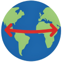

# GeoLink

Extensão para Google Chrome que alterna rapidamente uma coordenada entre o **Google Maps** e o **[topographic-map.com](https://pt-br.topographic-map.com)** e gera a **visada (perfil de elevação com linha de visada e zona de Fresnel)** entre dois pontos medidos no Google Maps — útil para planejar enlaces de rádio, como repetidores LoRa/MeshCore.

**Versão atual: 1.1**

## Funcionalidades

Cada procedimento tem um botão **?** no popup que explica como usá-lo.

### Google Maps → Mapa topográfico

Copie uma coordenada no Google Maps (botão direito no ponto → clique na coordenada, ex.: `-23.55052, -46.63330`) e abra o popup. A extensão detecta a coordenada na área de transferência e o botão **Abrir Mapa Topográfico** abre o local no topographic-map.com, com zoom 12 e marcador. As coordenadas são truncadas para 5 casas decimais.

### Mapa topográfico → Google Maps

Com uma página do topographic-map.com aberta e um ponto marcado (parâmetro `popup` na URL), o botão **Abrir esta localização no Google Maps** abre o mesmo ponto no Google Maps.

### Google Maps → Visada entre 2 pontos

1. No Google Maps, clique com o botão direito no ponto de origem → **Medir distância** e clique no ponto de destino.
2. Com a medição aberta, abra o popup: ele mostra os pontos A e B e a distância.
3. Só são aceitas medições com **exatamente 2 pontos**; com 1 ou com 3 ou mais pontos os botões ficam desabilitados.

Dois botões geram a visada:

- **Gerar visada (GeoLink)** — abre a visada **sobre a página do Google Maps** (feche com o **X** no canto ou com **Esc** e volte ao mapa com a medição intacta). Mostra:
  - perfil do terreno entre os pontos, com a **curvatura da Terra** (refração padrão, k = 4/3);
  - **linha de visada** entre o topo das antenas e a **1ª zona de Fresnel**;
  - diagnóstico: ✅ visada livre (Fresnel ≥ 60%), ⚠️ visada livre com Fresnel obstruída ou ❌ visada obstruída, com o ponto mais crítico marcado no gráfico;
  - distância, altitude do terreno em A e B, desnível, folga mínima, Fresnel livre mínima e raio de Fresnel no meio do enlace;
  - detalhes de cada ponto do perfil ao passar o mouse no gráfico.

  **Altura das antenas A e B** (padrão 10 m) e **frequência** (padrão 915 MHz) são editáveis, recalculam na hora e ficam salvas para as próximas visadas.

  Elevações: [OpenTopoData](https://www.opentopodata.org) (SRTM 30 m, gratuita, máx. 1 chamada/s e 1.000/dia); se estiver indisponível, usa o [Open-Meteo](https://open-meteo.com/en/docs/elevation-api) (Copernicus DEM 90 m, gratuito para uso não comercial). Os modelos não mostram detalhes menores que a sua resolução (prédios, árvores, pequenos morros), então considere uma margem.

- **Gerar visada no [Solwise](https://www.solwise.co.uk/wireless-elevationtool.html)** — abre a ferramenta de elevação do Solwise já com os dois marcadores e o perfil do terreno. Depende da cota da chave do Google usada pelo site, que às vezes se esgota (`OVER_QUERY_LIMIT`); nesse caso a extensão avisa e a alternativa é a visada do GeoLink.

#### Como os pontos da medição são lidos

O Google Maps não coloca os pontos de **Medir distância** na URL nem no HTML; eles ficam num objeto interno com nomes ofuscados, que mudam a cada versão do site. A extensão localiza esse objeto pela **forma** (lista de pontos `[_, lon, lat]` com uma lista vizinha do mesmo tamanho), não pelo nome — funciona nos modos Mapa e Satélite e depois de recarregar a página. Mesmo assim, uma mudança interna do Google Maps pode exigir ajuste na função `detectarMedicao` de `popup.js`.

## Instalação

1. Clone ou baixe este repositório.
2. Acesse `chrome://extensions` e ative o **Modo do desenvolvedor**.
3. Clique em **Carregar sem compactação** e selecione a pasta do projeto.

### Atualizando de uma versão anterior

Após baixar a nova versão, clique em **recarregar** (↻) no cartão do GeoLink em `chrome://extensions`. Como a versão 1.1 adiciona permissões, se aparecer algum erro remova a extensão e carregue a pasta novamente. Recarregue também as abas do Google Maps que já estavam abertas.

## Permissões

| Permissão | Uso |
|---|---|
| `clipboardRead` | Ler a coordenada copiada |
| `tabs` / `activeTab` | Ler a URL da aba atual e abrir novas abas |
| `scripting` | Ler a medição de distância no Google Maps, abrir a visada sobre o mapa e aplicar os pontos no Solwise |
| `https://www.solwise.co.uk/*` | Acessar a ferramenta de elevação do Solwise |
| `https://api.opentopodata.org/*`, `https://api.open-meteo.com/*` | Buscar as elevações do perfil de visada |

A página da visada é declarada em `web_accessible_resources` apenas para `google.com` e `google.com.br`, para poder ser exibida sobre o Google Maps.

## Estrutura

- `manifest.json` — manifesto da extensão (Manifest V3)
- `popup.html` / `popup.js` — interface do popup, detecção da medição no Google Maps e abertura da visada sobre o mapa
- `visada.html` / `visada.js` — página da visada (elevação, linha de visada, Fresnel, curvatura da Terra)
- `background.js` — abre o Solwise e aplica os dois pontos
- `icon*.png`, `geolink.png` — ícones

## Histórico de versões

### 1.1

- Visada entre 2 pontos medidos com **Medir distância** no Google Maps (recusa medições com mais de 2 pontos).
- Página de visada própria, aberta sobre o Google Maps: perfil do terreno (OpenTopoData SRTM 30 m / Open-Meteo), curvatura da Terra, 1ª zona de Fresnel, diagnóstico e altura das antenas e frequência editáveis.
- Botão para gerar a visada no Solwise com os dois pontos já aplicados.
- Cabeçalho com ícone e nome no popup e botões **?** com a explicação de cada procedimento.

### 1.0

- Google Maps → topographic-map.com a partir da coordenada copiada.
- topographic-map.com → Google Maps.
